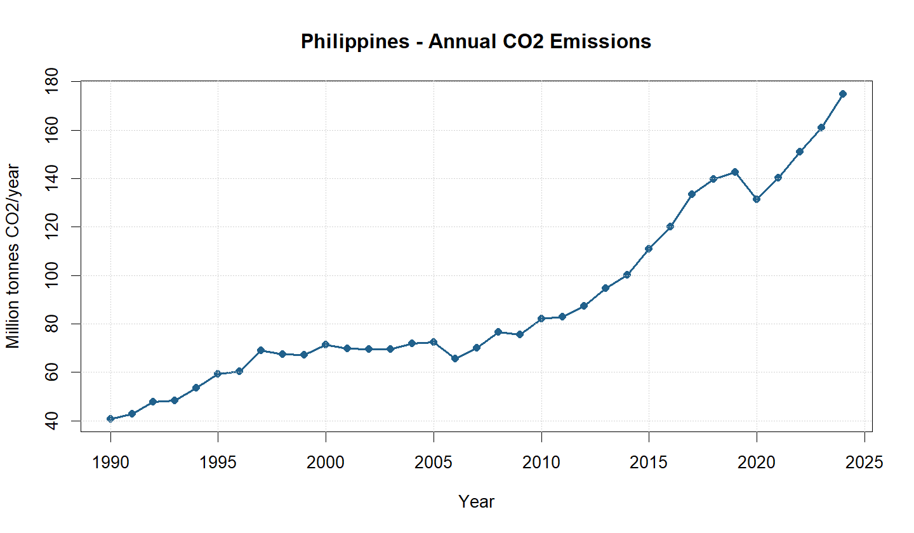
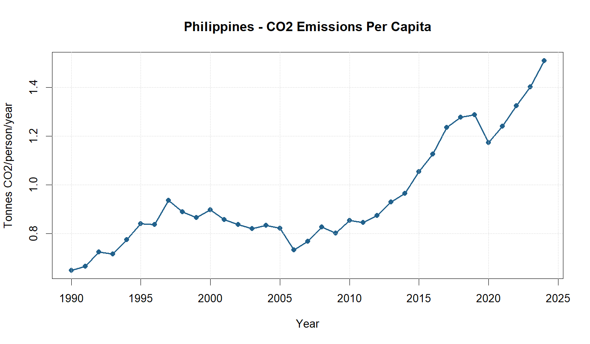
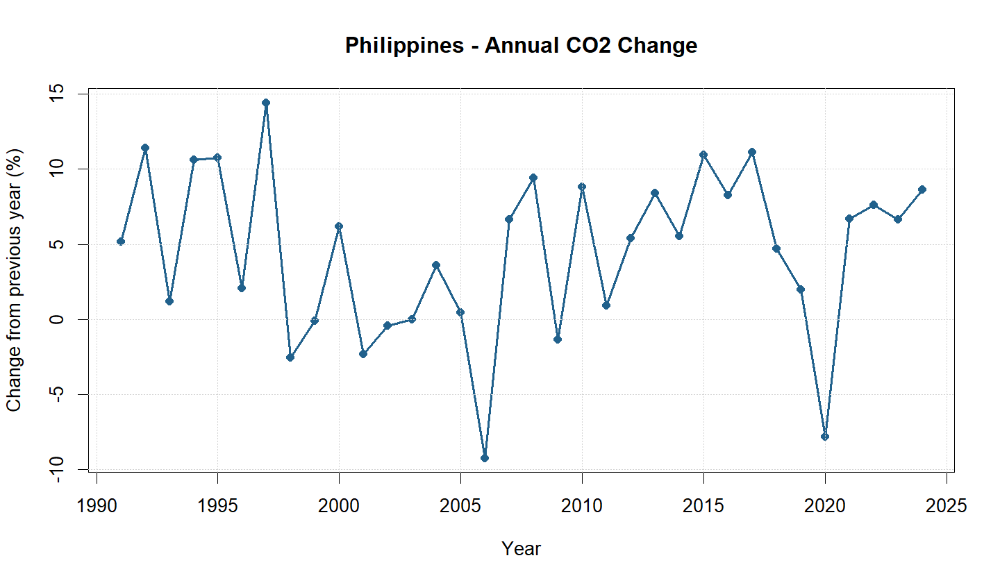

# co2-emissions-PHL
Philippines CO2 Emissions Analysis 1990-2024
# CO₂ Emissions Analysis: Philippines (1990–2024)

**Student:** [Enter your full name]  
**Country / ISO-3:** Philippines / PHL  
**Study period:** 1990–2024  
**Declared to instructor on:** [Enter declaration date]

## 1. Research Question

How have annual CO₂ emissions and per-capita CO₂ emissions changed in the Philippines from 1990 to 2024?

## 2. Data Source and Description

This analysis uses the Our World in Data (OWID) CO₂ and Greenhouse Gas Emissions dataset.

**Dataset:** https://github.com/owid/co2-data  
**Direct CSV:** https://owid-public.owid.io/data/co2/owid-co2-data.csv  
**Downloaded:** November 9, 2026

The analysis uses the following variables:

- `year` – Year of observation.
- `co2` – Annual CO₂ emissions, measured in million tonnes.
- `co2_per_capita` – Annual CO₂ emissions per person, measured in tonnes per person.

The Philippines was selected using its ISO-3 country code, PHL. The study covers 35 annual observations from 1990 to 2024.

## 3. Methodology

The dataset was processed and analyzed using RStudio and base R functions. The complete OWID dataset was filtered to obtain Philippines-specific observations. Three line graphs were generated to examine annual CO₂ emissions, per-capita emissions, and annual percentage changes.

Summary statistics were calculated to identify the initial and final emissions values, overall percentage change, peak emissions year, and latest available per-capita value.

## 4. How to Reproduce the Analysis

1. Install R, RStudio, and Git.
2. Open this repository as an RStudio Project.
3. Ensure an internet connection is available for the initial dataset download.
4. Run the following command in the RStudio Console:

```r
source("scripts/analyze_co2.R")
```

5. Check the generated files in the `data/`, `figures/`, and `results/` folders.

## 5. Results

The analysis produced the following results:

| Indicator | Result |
|---|---:|
| First year | 1990 |
| Last year | 2024 |
| CO₂ emissions in 1990 | 40.77 Mt |
| CO₂ emissions in 2024 | 174.88 Mt |
| Overall percentage increase | 328.90% |
| Peak emissions year | 2024 |
| Peak CO₂ emissions | 174.88 Mt |
| Latest per-capita emissions | 1.51 tonnes/person |

### Figures

**Figure 1. Annual CO₂ emissions in the Philippines (1990–2024).**



**Figure 2. CO₂ emissions per capita in the Philippines (1990–2024).**



**Figure 3. Annual percentage change in CO₂ emissions in the Philippines (1990–2024).**



## 6. Interpretation and Discussion

The analysis revealed a substantial increase in CO₂ emissions in the Philippines between 1990 and 2024. Annual emissions increased from 40.77 million tonnes in 1990 to 174.88 million tonnes in 2024, representing an overall increase of 328.90%. The highest emissions level occurred in 2024. Per-capita emissions also increased from 0.65 tonnes per person in 1990 to 1.51 tonnes per person in 2024, indicating that emissions increased relative to population size.

Despite the general upward trend, annual emissions did not increase consistently. The graphs show fluctuations throughout the study period, including a noticeable decline in 2020, followed by renewed growth in subsequent years. This pattern demonstrates that national emissions can change from year to year rather than follow a constant rate of increase.

A possible contextual explanation is the country's growing energy demand and continued dependence on fossil fuels. The World Bank (2023) discussed how economic growth, fossil-fuel-dependent industries, and increasing energy consumption contribute to the Philippines' rising emissions. However, these factors were not directly tested in this analysis and should not be interpreted as proven causes of the observed trend.

Overall, the findings emphasize the importance of sustainable energy development, improved energy efficiency, and continued monitoring of national CO₂ emissions.

## 7. Limitations

- The analysis focuses on CO₂ emissions and does not represent all greenhouse gases.
- The dataset uses territorial emissions accounting and does not measure the full carbon footprint of imported goods consumed in the Philippines.
- Land-use change and forestry emissions are not included in the selected CO₂ indicator.
- Missing observations, if present, may affect some calculations and graphs.
- The analysis is descriptive and cannot establish the causes of changes in emissions.

## 8. References

1. Our World in Data. (n.d.). *CO₂ and Greenhouse Gas Emissions*. https://github.com/owid/co2-data
2. World Bank. (2023). *Philippines Economic Update: June 2023*. https://thedocs.worldbank.org/en/doc/c4aa826d0cda3d9b21db1adc4f8e1787-0070062023/original/World-Bank-Philippines-Economic-Update-June-2023.pdf

